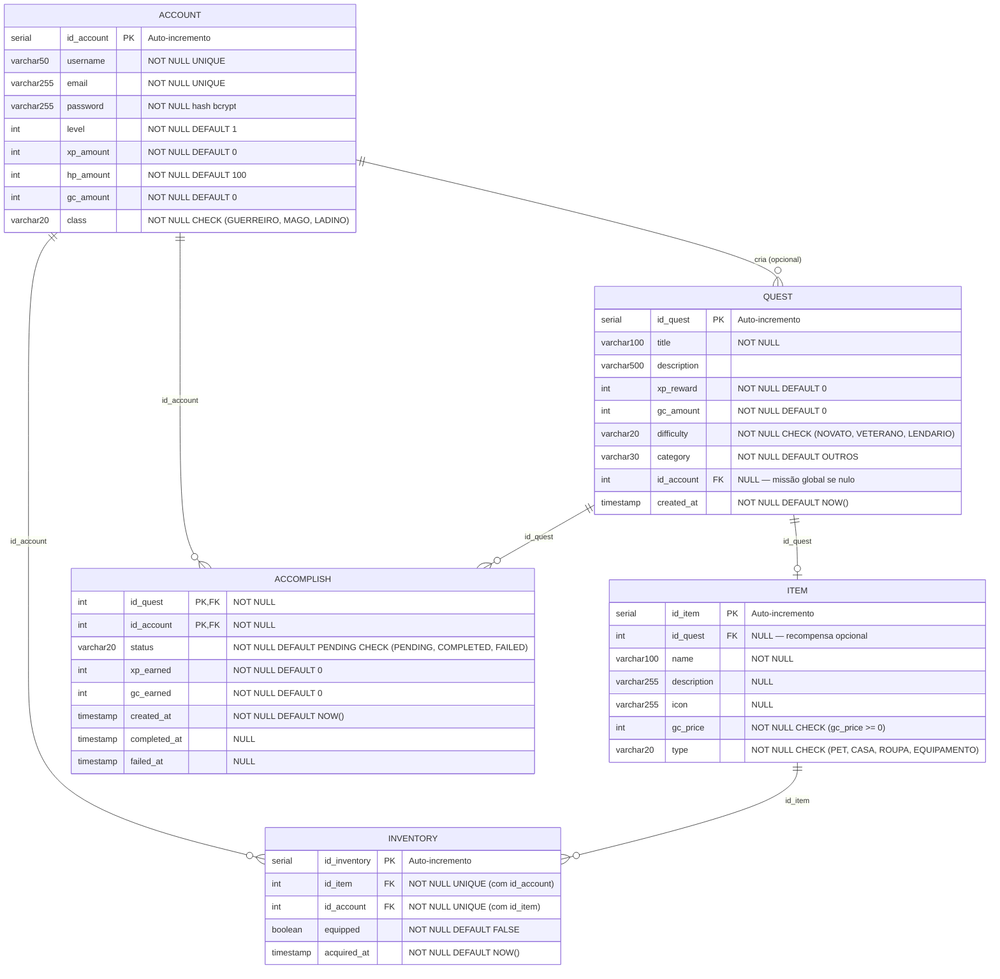

# DER Relacional — Level-Up

Diagrama Relacional com tipos de dados, chaves primárias e estrangeiras.



---

## ENUMs (persistidos como `VARCHAR` + `CHECK` compatível com JPA `@Enumerated(EnumType.STRING)`)

```sql
-- class:                'GUERREIRO' (Mais HP), 'MAGO' (Mais XP em estudos), 'LADINO' (Mais ouro)
-- difficulty:           'NOVATO' (10 XP / 5 GC), 'VETERANO' (30 XP / 15 GC), 'LENDARIO' (100 XP / 50 GC; API aceita/retorna 'LENDÁRIO')
-- category:             'SAUDE', 'ESTUDOS', 'AGENDA', 'PLANEJAMENTO', 'ORGANIZACAO', 'LAZER', 'FINANCAS', 'OUTROS'
-- status (Accomplish):  'PENDING', 'COMPLETED', 'FAILED'
-- type (Item):          'PET', 'CASA', 'ROUPA', 'EQUIPAMENTO'
```

---

## Script SQL Completo

```sql
-- ─── TABELAS ─────────────────────────────────────────────────────

CREATE TABLE Account (
    id_account  SERIAL          PRIMARY KEY,
    username    VARCHAR(50)     NOT NULL UNIQUE,
    email       VARCHAR(255)    NOT NULL UNIQUE,
    password    VARCHAR(255)    NOT NULL,
    level       INT             NOT NULL DEFAULT 1,
    xp_amount   INT             NOT NULL DEFAULT 0,
    hp_amount   INT             NOT NULL DEFAULT 100,
    gc_amount   INT             NOT NULL DEFAULT 0,
    class       VARCHAR(20)     NOT NULL CHECK (class IN ('GUERREIRO', 'MAGO', 'LADINO'))
);

CREATE TABLE Quest (
    id_quest    SERIAL          PRIMARY KEY,
    title       VARCHAR(100)    NOT NULL,
    description VARCHAR(500),
    xp_reward   INT             NOT NULL DEFAULT 0,
    gc_amount   INT             NOT NULL DEFAULT 0,
    difficulty  VARCHAR(20)     NOT NULL CHECK (difficulty IN ('NOVATO', 'VETERANO', 'LENDARIO')),
    category    VARCHAR(30)     NOT NULL DEFAULT 'OUTROS' CHECK (category IN ('SAUDE', 'ESTUDOS', 'AGENDA', 'PLANEJAMENTO', 'ORGANIZACAO', 'LAZER', 'FINANCAS', 'OUTROS')),
    id_account  INT,
    created_at  TIMESTAMP       NOT NULL DEFAULT NOW()
);

CREATE TABLE Item (
    id_item     SERIAL          PRIMARY KEY,
    id_quest    INT,
    name        VARCHAR(100)    NOT NULL,
    description VARCHAR(255),
    icon        VARCHAR(255),
    gc_price    INT             NOT NULL CHECK (gc_price >= 0),
    type        VARCHAR(20)     NOT NULL CHECK (type IN ('PET', 'CASA', 'ROUPA', 'EQUIPAMENTO'))
);

CREATE TABLE Inventory (
    id_inventory    SERIAL      PRIMARY KEY,
    id_item         INT         NOT NULL,
    id_account      INT         NOT NULL,
    equipped        BOOLEAN     NOT NULL DEFAULT FALSE,
    acquired_at     TIMESTAMP   NOT NULL DEFAULT NOW(),
    CONSTRAINT uq_inventory_account_item UNIQUE (id_account, id_item)
);

CREATE TABLE Accomplish (
    id_quest        INT         NOT NULL,
    id_account      INT         NOT NULL,
    status          VARCHAR(20) NOT NULL DEFAULT 'PENDING' CHECK (status IN ('PENDING', 'COMPLETED', 'FAILED')),
    xp_earned       INT         NOT NULL DEFAULT 0,
    gc_earned       INT         NOT NULL DEFAULT 0,
    created_at      TIMESTAMP   NOT NULL DEFAULT NOW(),
    completed_at    TIMESTAMP,
    failed_at       TIMESTAMP,
    PRIMARY KEY (id_quest, id_account)
);

-- ─── FOREIGN KEYS ────────────────────────────────────────────────

ALTER TABLE Quest
    ADD CONSTRAINT fk_quest_account
    FOREIGN KEY (id_account) REFERENCES Account (id_account)
    ON DELETE CASCADE;

ALTER TABLE Item
    ADD CONSTRAINT fk_item_quest
    FOREIGN KEY (id_quest) REFERENCES Quest (id_quest)
    ON DELETE SET NULL;

ALTER TABLE Inventory
    ADD CONSTRAINT fk_inventory_item
    FOREIGN KEY (id_item) REFERENCES Item (id_item)
    ON DELETE CASCADE;

ALTER TABLE Inventory
    ADD CONSTRAINT fk_inventory_account
    FOREIGN KEY (id_account) REFERENCES Account (id_account)
    ON DELETE CASCADE;

ALTER TABLE Accomplish
    ADD CONSTRAINT fk_accomplish_quest
    FOREIGN KEY (id_quest) REFERENCES Quest (id_quest)
    ON DELETE CASCADE;

ALTER TABLE Accomplish
    ADD CONSTRAINT fk_accomplish_account
    FOREIGN KEY (id_account) REFERENCES Account (id_account)
    ON DELETE CASCADE;

-- ─── ÍNDICES ─────────────────────────────────────────────────────

CREATE INDEX idx_quest_account        ON Quest(id_account);
CREATE INDEX idx_item_quest           ON Item(id_quest);
CREATE INDEX idx_inventory_account    ON Inventory(id_account);
CREATE INDEX idx_inventory_item       ON Inventory(id_item);
CREATE INDEX idx_accomplish_account   ON Accomplish(id_account);
CREATE INDEX idx_accomplish_status    ON Accomplish(id_account, status);
CREATE INDEX idx_accomplish_quest     ON Accomplish(id_quest);

-- ─── SEED (dados iniciais) ────────────────────────────────────────

INSERT INTO Item (name, description, icon, gc_price, type) VALUES
    ('Armadura Anciã',    'Vestes encantadas de um herói esquecido.',            NULL,                       200, 'ROUPA'),
    ('Casa Nova',         'Um lar aconchegante para descansar após as missões.', '/banners/banner_casa.png', 150, 'CASA'),
    ('Dragão Filhote',    'Um companheiro leal que solta faíscas.',              NULL,                       500, 'PET'),
    ('Espada Curta',      'Uma lâmina leve para iniciantes.',                    '/ui/espada.png',           350, 'EQUIPAMENTO'),
    ('Escudo de Madeira', 'Proteção básica feita de carvalho.',                  '/ui/escudo.png',           200, 'EQUIPAMENTO');
```

---

## Regras de Negócio Implementadas

| Regra | Implementação |
|-------|--------------|
| Um item pode ser recompensa de no máximo uma quest | `id_quest` em Item é FK nullable (0,1) |
| Um usuário pode ter vários itens no inventário | Tabela Inventory N:M |
| Cada conta possui no máximo 1 unidade por item | `CONSTRAINT uq_inventory_account_item UNIQUE (id_account, id_item)` |
| Apenas 1 item equipado por tipo por conta | Regra no `InventoryService` + lock pessimista na conta |
| Venda devolve 50% do preço do item | `Item.getSellPrice()` (`floor(gcPrice * 0.5)`) |
| Compra, venda e equipamento são atômicos | `@Transactional` + lock pessimista (`findByIdForUpdate`) |
| Um usuário pode completar várias quests | Tabela Accomplish N:M |
| Deletar account remove missões privadas, inventário e conquistas | `ON DELETE CASCADE` |
| Deletar quest não deleta o item recompensa | `ON DELETE SET NULL` |
| Senhas nunca em texto plano | Hash bcrypt no backend |
